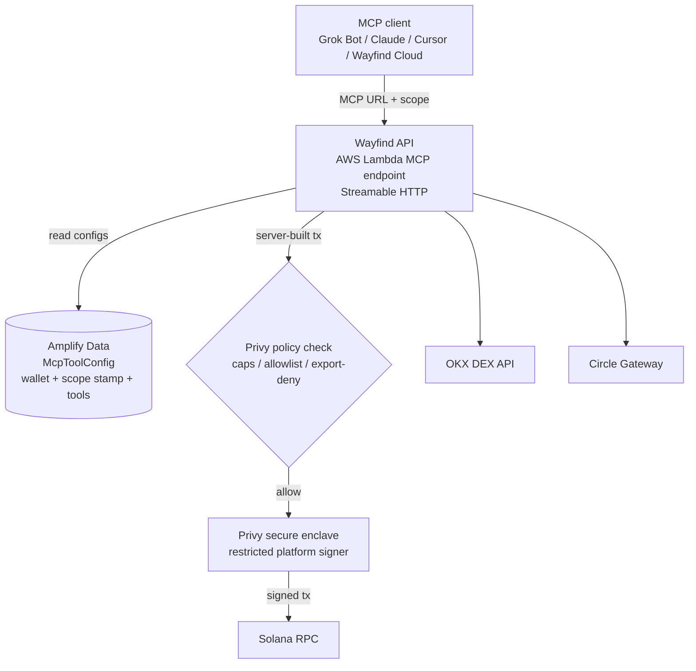

<p align="center"><strong>Wayfind Web3 Gateway for AI Agents</strong></p>

# Wayfind Web3 Gateway for AI Agents

> Give always-on agents like Grok Bot on-chain access via a remote MCP server — with scoped tools and Privy delegated signing.

**Your AI Bots can now transact onchain.** One remote MCP server connects Grok Bot,
Claude, or Cursor to your Solana wallet. Spending caps and program allowlists are
enforced by Privy before anything is signed.

## Highlights

- **One remote MCP server** — a single Streamable-HTTP endpoint per wallet and scope. No local machine, no private keys on any device.
- **You own the wallet** — sign in with email to get a Privy embedded wallet. Wayfind is added as a restricted signer under policies you approve.
- **10+ tools, 3 categories** — Wallet Operations, OKX DEX Swaps, Stablecoin Finance. Enable only what each Bot may call.
- **Enforceable policies** — spending caps (≤1 SOL / ≤5 USDC), a tight 8-program allowlist, or the default no-export policy. Revoke anytime.
- **Works out of the box** — Grok Bot, Claude, Cursor, VS Code, any MCP client, and Bots in Wayfind Cloud (Connectors → Web3).

## Why a Web3 gateway

Chat bots can read blockchains but can't act on them — and handing a bot your
private key is not an option. Wayfind Web3 splits the problem: the bot only ever
sees an MCP URL, while signing stays inside Privy's secure enclaves under a
policy you chose. Every transaction is built server-side from fixed templates,
signed by a restricted signer, and checked against your policy before broadcast.

### Security boundaries

- The agent never touches Privy and never sees a private key. It calls MCP tools; the Lambda builds the transaction.
- Private-key export is denied under every policy, including the default.
- The backend only ever uses `signTransaction` / `signMessage` through its own platform signer. It cannot change the policy — policy assignment happens at authorize time.
- Scope is stamped at URL issuance: a testnet URL can never move mainnet funds, and old URLs keep their original scope after a scope switch.

## Tools

| Category | Tool | What it does |
|---|---|---|
| Wallet Operations | `get_wallet_address` | Show the attached wallet address and network |
| | `get_balances` | Read SOL plus every token balance, including stocks |
| | `get_history` | Read the latest transactions, newest first |
| | `get_transaction` | Look up one transaction by signature |
| | `send_tokens` | Send SOL or SPL tokens by symbol. Policy-enforced |
| OKX DEX Swaps | `okx_get_quote` | Read-only swap quote (Solana mainnet) |
| | `okx_swap_tokens` | Swap via OKX DEX. Mainnet only, policy-enforced |
| Stablecoin Finance | `usdc_unified_balance` | Total USDC + per-chain breakdown. Read-only |
| | `usdc_chains` | Valid destination chains for the current network. Read-only |
| | `usdc_deposit` | Deposit USDC into unified balance. Policy-enforced |
| | `usdc_spend` | Spend USDC, optionally cross-chain. Policy-enforced |

New MCP URLs start with zero tools enabled — add them per URL in the app's Tools page.

## Quick start (user flow)

1. **Sign in** — email login creates your Privy embedded wallet automatically.
2. **Add tools** — in `/app/tools`, enable only the tools each Bot may call.
3. **Connect** — in `/app/connect`, generate the MCP URL and paste it into your client:
   Grok Bot, Claude, Cursor, VS Code — or Wayfind Cloud via Connectors (bottom-left) → Web3.
4. **Fund & authorize** — fund the wallet, then in `/app/authorization` pick a policy
   (Default, Spending caps, or Tight allowlist) and authorize Wayfind as a signer.
5. **Use it** — ask your client to check a balance. Writes are policy-checked on every signature.


## Architecture



## Policies

| Policy | Enforces |
|---|---|
| Default — no key exports | Blocks private-key export, allows everything else |
| Spending caps | ≤1 SOL and ≤5 USDC per transaction; swaps via Jupiter or OKX only |
| Tight allowlist | Only 8 known programs (System, Token ×2, Associated Token, Memo, Compute Budget, Jupiter, OKX router) |

Policy is chosen per wallet at authorize time and stamped by Privy — the app reads
live state, not a copy. Notes:

- Privy rejects condition-less `signTransaction` rules, so signing permissions mirror the instruction-level rules on both signing methods.
- Address-based conditions (e.g. recipient allowlists) fail on transactions using Address Lookup Tables — the policies use program and amount conditions instead, which are ALT-safe.
- Gateway deposits need the Circle Gateway program added to the tight allowlist before they pass under it.

## Local development

### Requirements

- Node.js 20+ and npm
- An AWS account configured for AWS Amplify
- A Privy app (email login + Solana embedded wallets enabled)

Install with `--legacy-peer-deps` (the Circle kits bundle their own web3.js v1,
which conflicts at peer resolution — the app aliases it separately at build time).

### Clone and install

```bash
git clone https://github.com/tamago-labs/wayfind-web3-gateway.git
cd wayfind-web3
npm install --legacy-peer-deps
```

### Configure environment variables

Create `.env.local` (gitignored). Plain IDs go in as values; secrets are stored as
Amplify `secret()` entries for deployed environments and mirrored in `.env.local`
for the sandbox. See `amplify/functions/propose-signer/resource.ts` and
`amplify/functions/wayfind-api/resource.ts` for the authoritative list.

```bash
# Public / plain
NEXT_PUBLIC_PRIVY_APP_ID=
PRIVY_APP_ID=
PRIVY_SIGNER_ID=
PRIVY_SIGNER_NAME=
PRIVY_DEFAULT_POLICY_ID=
PRIVY_SPENDING_CAPS_POLICY_ID=
PRIVY_TIGHT_POLICY_ID=
NEXT_PUBLIC_SOLANA_DEVNET_RPC=
NEXT_PUBLIC_SOLANA_MAINNET_RPC=

# Secrets (Amplify secret() in deployed envs)
PRIVY_APP_SECRET=
PRIVY_AUTH_PRIVATE_KEY=      # format: wallet-auth:<base64>
OKX_API_KEY=
OKX_SECRET_KEY=
OKX_PASSPHRASE=
```

The sandbox and hosted environments need their secrets set separately — a key that
exists only in `.env.local` will fail closed in a deployed Lambda.

### Run locally

```bash
npx ampx sandbox
npm run dev
```

Open http://localhost:3000.

### Checks

```bash
npx tsc --noEmit                       # must be clean (ignoring pre-existing $amplify/env stubs)
npx tsx scripts/privy-tests/run.ts     # Privy connection, policy, and signer checks
```

## Verify

1. `tools/list` on a fresh URL returns zero tools; enable tools in `/app/tools` and confirm they appear.
2. Authorize a devnet wallet under Spending caps: a small SOL send succeeds, an over-cap send is denied with a policy error.
3. Read-only tools (`get_balances`, `get_history`, `okx_get_quote`) work without authorization.
4. After any backend deploy, allow a minute for propagation — the endpoint can return transient `403 {"Message":null}` responses while the new revision rolls out.

## Repository layout

| Path | What lives here |
|---|---|
| `app/` | Next.js pages — landing (`/`) and console (`/app/*`) |
| `components/landing/` | Landing sections (Hero, Features, How, UseCases, Connectors, CTA, Footer) |
| `components/app/` | Console components (ToolsConsole, McpAccessCard, McpClientTabs, Authorization) |
| `amplify/functions/wayfind-api/` | MCP endpoint: registry, tools, shared libs (rpc, privy, tokens, tx, okx, circle) |
| `amplify/functions/propose-signer/` | Signer discovery + policy selection for authorization |
| `amplify/functions/wallet-state/` | Live wallet/delegation reads from Privy |
| `amplify/data/` | Data schema (`McpToolConfig`, function bindings) |
| `data/tokens/` | Mainnet/devnet token registry + prepare script |
| `scripts/privy-tests/` | Privy connection, policy, and signer check scripts |

## Project status

Under development on Solana devnet, with mainnet paths (OKX swaps, USDC finance)
guarded by scope + policy.

- Wayfind Cloud: https://wayfind.click (Connectors → Web3)
- Gateway repo: https://github.com/tamago-labs/wayfind-web3-gateway

## License

MIT
