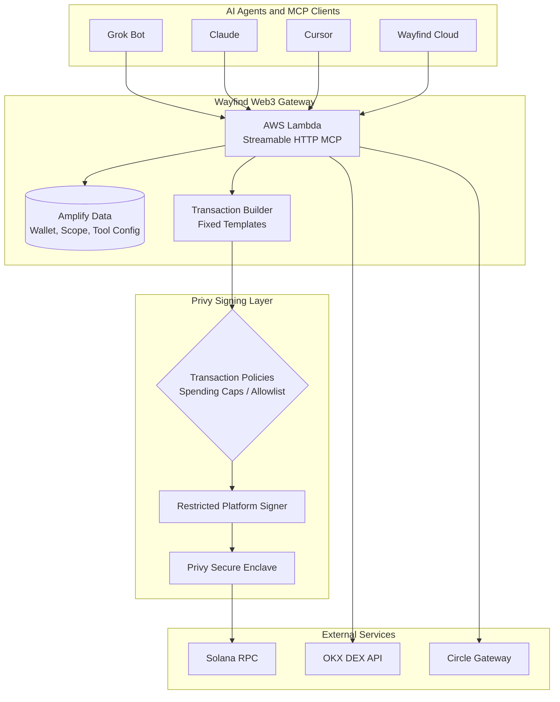

# Wayfind Web3 Gateway for AI Agents

**Give your AI agents permission-controlled access to your onchain wallet.**

Wayfind Web3 connects AI agents to your Solana wallet through a remote MCP server. Instead of sharing private keys or asking an agent to manage a wallet, you give it access to a set of blockchain tools with permissions you control.

Connect Grok Bot, Claude, Cursor, or your Wayfind Cloud Bots. They can check balances, send tokens, execute DEX swaps, and manage stablecoin operations — while Privy handles transaction signing under policies you authorize.

**Your wallet. Your policies. Your AI agents.**

## Why Wayfind Web3

AI agents are becoming increasingly capable of handling real work, but interacting with blockchains introduces a different challenge: how do you let an agent execute transactions without giving it unrestricted control of your wallet?

Giving an agent a private key is not a practical solution. A compromised agent, an unexpected instruction, or a poorly configured workflow could result in irreversible transactions.

Wayfind Web3 provides a separate permission layer between AI agents and your wallet.

- **Keep your keys protected.** Your agent never receives your private key. Transaction signing happens through Privy's restricted platform signer.
- **Control what agents can do.** Enable only the MCP tools you want each agent to access, from reading balances to sending tokens and executing swaps.
- **Set transaction policies.** Apply spending caps or restrict transactions to an allowlist of known programs.
- **Connect from anywhere.** Use one remote MCP endpoint without running a local server or keeping your computer online.
- **Stay in control.** Authorization can be revoked, and different MCP URLs can have separate tools and network scopes.

The result is a practical way to give AI agents onchain capabilities without handing over ownership of your wallet.

## What can your AI agents do?

Wayfind Web3 currently provides more than 10 MCP tools across three categories.

### Wallet operations

Give agents visibility into your wallet and the ability to perform basic token operations.

- Check wallet addresses and network information.
- Read SOL and token balances, including tokenized stocks.
- Review recent transaction history.
- Look up individual transactions.
- Send SOL and SPL tokens by symbol, subject to your authorization policy.

### DEX swaps

Let agents interact with decentralized exchanges through OKX DEX.

- Retrieve token swap quotes.
- Execute token swaps through OKX DEX.
- Apply transaction policies before signing.

### Stablecoin finance

Connect agents to Circle's USDC unified balance infrastructure.

- Check total USDC balances across supported chains.
- Discover available destination chains.
- Deposit USDC into a unified balance.
- Spend USDC, including supported cross-chain operations.

These capabilities allow an AI agent to move beyond simply answering questions about blockchain data. It can perform real onchain operations when the required tools and permissions are enabled.

## How it works

Wayfind Web3 separates the agent, the transaction gateway, and the wallet signer.

1. **Connect an agent.** Generate a remote MCP URL and add it to Grok Bot, Claude, Cursor, or another compatible MCP client.
2. **Choose its capabilities.** Enable the tools that the agent is allowed to use. Every new MCP URL starts with zero tools enabled.
3. **Authorize signing.** Choose a Privy policy and authorize Wayfind as a restricted signer for your embedded wallet.
4. **Let the agent work.** The agent calls MCP tools. Wayfind builds transactions server-side and submits them for signing under your authorized policy.

The agent only interacts with the MCP interface. It never receives your private key or communicates directly with Privy.

## Security and permissions

Security is built around separating wallet ownership, agent access, and transaction signing.

### Your wallet remains yours

Sign in with email to create a Privy embedded Solana wallet. You own and control the wallet, while Wayfind is added as a restricted signer only after you authorize it.

The agent never receives wallet credentials or private-key material.

### Transaction policies

Choose the level of transaction control that fits your workflow.

| Policy | What it enforces |
|---|---|
| Default | Blocks private-key export while allowing other signing operations |
| Spending caps | Limits transactions to ≤1 SOL and ≤5 USDC per transaction; restricts swaps to Jupiter or OKX |
| Tight allowlist | Restricts transactions to 8 known programs, including System, Token, Associated Token, Memo, Compute Budget, Jupiter, and OKX |

Policies are assigned through Privy during authorization. Privy evaluates the applicable conditions when signing is requested.

**Important:** The Default policy is an export-protection policy, not a general transaction restriction. Use Spending caps or Tight allowlist when you need additional transaction controls.

### Additional security boundaries

- **No agent-side signing:** Agents invoke MCP tools, while the backend constructs transactions and uses its restricted platform signer.
- **No private-key export:** Private-key export is denied under every policy.
- **Server-side transaction construction:** Transactions are assembled from predefined server-side templates rather than arbitrary transaction payloads supplied by the agent.
- **Scope isolation:** Network scope is stamped when an MCP URL is issued. A devnet URL cannot be switched to mainnet simply by changing the application setting.
- **Revocable authorization:** You can revoke Wayfind's signer authorization when it is no longer needed.

### Policy implementation notes

- Privy rejects condition-less `signTransaction` rules, so signing permissions mirror instruction-level rules across both signing methods.
- Address-based recipient conditions can fail with transactions using Address Lookup Tables. The current policies use program and amount conditions instead.
- Circle Gateway deposits require the Circle Gateway program to be included in the Tight allowlist before they can pass under that policy.

## Quick start

Get your first AI agent connected in a few steps.

### 1. Create your wallet

Visit the Wayfind Web3 application and sign in using your email.

A Privy embedded Solana wallet is created automatically. You don't need to configure a separate wallet or install a browser extension.

### 2. Enable tools

Open **Tools** in the application:

`/app/tools`

Choose which capabilities you want to expose to your AI agents.

For example, you can enable read-only tools first and add transaction capabilities when you're ready.

Each MCP URL maintains its own tool configuration. New URLs start with no tools enabled.

### 3. Connect your AI agent

Open **Connect**:

`/app/connect`

Generate an MCP URL and add it to your preferred client.

Supported clients include:

- Grok Bot
- Claude
- Cursor
- VS Code
- Other Streamable HTTP MCP clients
- Wayfind Cloud (Connectors → Web3)

Your client connects to the remote MCP server. No local MCP server installation is required.

### 4. Fund and authorize your wallet

Fund your wallet, then open:

`/app/authorization`

Choose one of the available policies:

- Default
- Spending caps
- Tight allowlist

Authorize Wayfind as a restricted signer through Privy.

Read-only operations can work without signing authorization. Transaction operations require the appropriate authorization and policy.

### 5. Start using onchain tools

Ask your AI agent to perform an operation, such as:

> Check my SOL and USDC balances.

Or:

> Get a quote for swapping 0.1 SOL into USDC.

For an authorized transaction:

> Send 5 USDC to the configured recipient.

Wayfind handles transaction construction, signing requests, policy enforcement, and broadcasting through the configured integrations.

## Architecture

Wayfind Web3 uses AWS Lambda for the remote MCP gateway, AWS Amplify for application data and backend integration, and Privy for embedded wallets and delegated transaction signing.



### Request lifecycle

1. **Connect:** An MCP client connects using a URL associated with a specific wallet and network scope.
2. **Discover:** The gateway reads the enabled tool configuration and exposes only the tools assigned to that URL.
3. **Execute:** When an agent calls a tool, the Lambda backend validates the request and constructs the transaction using predefined templates.
4. **Authorize:** Transaction signing is delegated to Privy, which evaluates the applicable signer permissions and policies.
5. **Broadcast:** An approved transaction is signed and submitted to the relevant blockchain network.

Read-only operations follow the relevant data-access path without requiring transaction signing.

This architecture keeps the AI agent outside the wallet-signing boundary while providing a consistent interface for onchain operations.

## Local development

### Requirements

- Node.js 20+ and npm
- An AWS account configured for AWS Amplify
- A Privy application with email login and Solana embedded wallets enabled

Install dependencies using `--legacy-peer-deps`. The Circle kits bundle their own web3.js v1, which conflicts during peer dependency resolution. The application aliases it separately at build time.

### Clone and install

```bash
git clone https://github.com/tamago-labs/wayfind-web3-gateway.git
cd wayfind-web3-gateway
npm install --legacy-peer-deps
```

### Environment configuration

Create a `.env.local` file (gitignored).

Plain configuration values:

```bash
NEXT_PUBLIC_PRIVY_APP_ID=
PRIVY_APP_ID=
PRIVY_SIGNER_ID=
PRIVY_SIGNER_NAME=
PRIVY_DEFAULT_POLICY_ID=
PRIVY_SPENDING_CAPS_POLICY_ID=
PRIVY_TIGHT_POLICY_ID=
NEXT_PUBLIC_SOLANA_DEVNET_RPC=
NEXT_PUBLIC_SOLANA_MAINNET_RPC=
```

Secrets:

```bash
PRIVY_APP_SECRET=
PRIVY_AUTH_PRIVATE_KEY=      # format: wallet-auth:<base64>
OKX_API_KEY=
OKX_SECRET_KEY=
OKX_PASSPHRASE=
```

For deployed environments, secrets are configured through Amplify `secret()` entries.

The local sandbox and hosted environments require separate secret configuration. A secret available only in `.env.local` will not be available to a deployed Lambda.

See `amplify/functions/propose-signer/resource.ts` and `amplify/functions/wayfind-api/resource.ts` for the authoritative environment variable definitions.

### Run locally

```bash
npx ampx sandbox
npm run dev
```

Open http://localhost:3000.

### Run checks

```bash
npx tsc --noEmit
npx tsx scripts/privy-tests/run.ts
```

The TypeScript check should be clean, accounting for pre-existing `$amplify/env` stubs.

## Verification

Use these checks to verify the main application flows.

1. Create a fresh MCP URL and confirm that `tools/list` returns zero tools.
2. Enable tools in `/app/tools` and confirm that they appear in the MCP tool list.
3. Authorize a devnet wallet under Spending caps.
4. Verify that a small SOL transfer succeeds and an over-cap transaction is denied with a policy error.
5. Confirm that read-only operations such as `get_balances`, `get_history`, and `okx_get_quote` work without signing authorization.
6. Deploy backend changes and allow approximately one minute for propagation. Transient `403 {"Message":null}` responses can occur while a new revision rolls out.

## Repository structure

| Path | Description |
|---|---|
| `app/` | Next.js application pages, including landing page and console |
| `components/landing/` | Landing page sections |
| `components/app/` | Application console components |
| `amplify/functions/wayfind-api/` | Remote MCP endpoint, tools, transaction handling, and integrations |
| `amplify/functions/propose-signer/` | Signer discovery and authorization policy selection |
| `amplify/functions/wallet-state/` | Live wallet and delegation state from Privy |
| `amplify/data/` | Amplify data schema and function bindings |
| `data/tokens/` | Mainnet and devnet token registries |
| `scripts/privy-tests/` | Privy integration and policy verification scripts |

## Project status

Wayfind Web3 is under active development, with support for both Solana Devnet and Mainnet.

Test your integrations on Devnet before moving to Mainnet. Real transactions are supported, but we recommend using small amounts while the project is evolving.

**Links**

- [Wayfind Cloud](https://wayfind.click) — Connectors → Web3
- [GitHub Repository](https://github.com/tamago-labs/wayfind-web3-gateway)
- [X Profile](https://x.com/WayfindCloud)

## License

MIT
